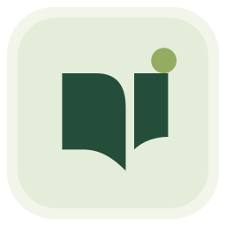
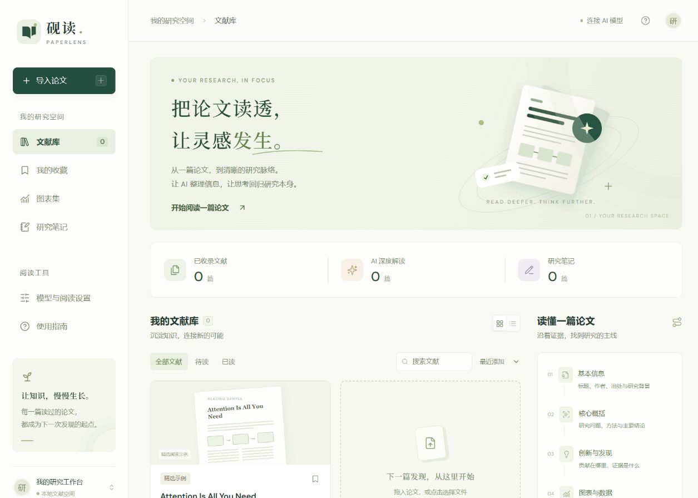
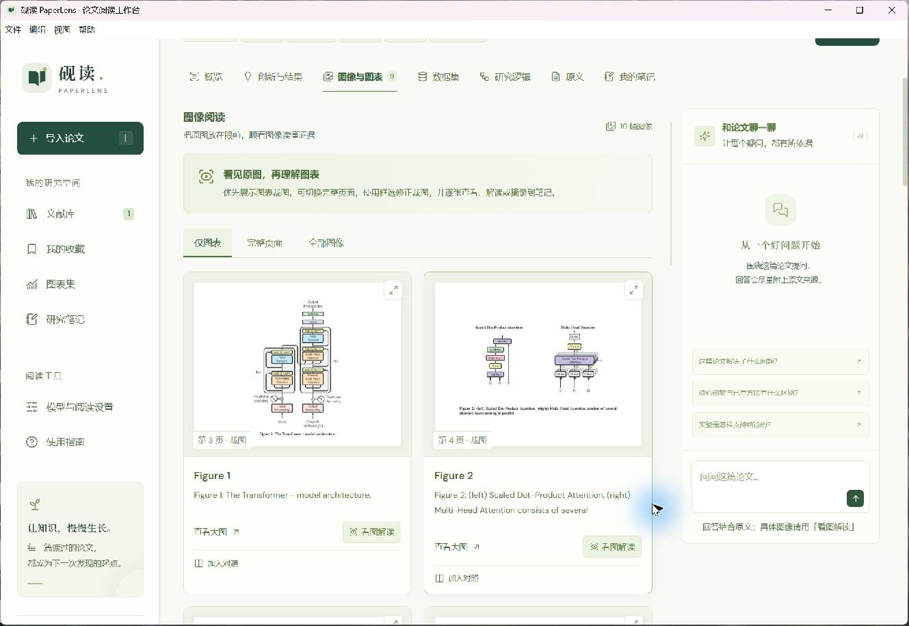
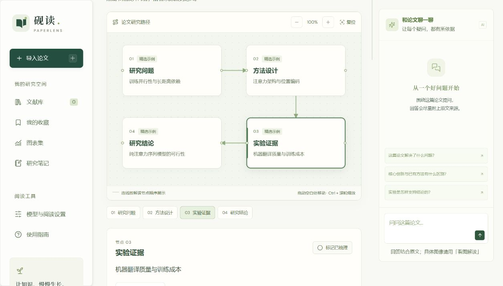
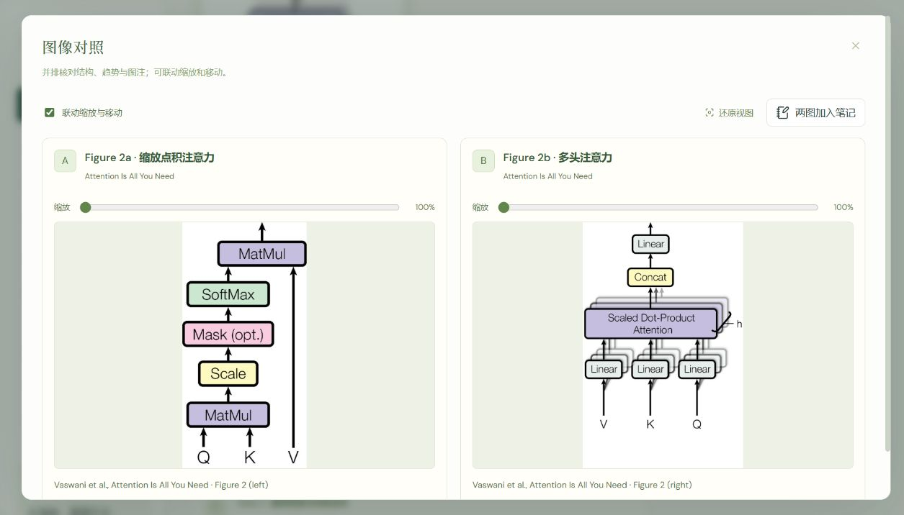

<div align="center">



# PaperLens · 砚读

**Read the paper. Follow the evidence. Keep the insight.**

A local workspace for Chinese and English research papers, with AI reading,
figure comparison and an interactive research canvas.

[中文](README.md) · [Get started](#get-started) · [Issues](https://github.com/suiyuancanyan/paperlens/issues)

[](LICENSE)
[](https://github.com/suiyuancanyan/paperlens/stargazers)

</div>

Drop in a PDF or Word document and work through its question, method,
contributions, results, figures and datasets. Jump back to source pages,
compare figures side by side, and collect your own notes alongside the paper.



## Features

- Batch PDF / DOCX import, text extraction and a local paper library.
- Structured AI analysis with source-page references.
- Figure crops, full-page views, zoom, manual cropping and image-aware analysis.
- Cross-paper figure comparison with linked zoom and panning.
- An interactive canvas connecting questions, methods, evidence and conclusions.
- Full-text search, selected-text translation, highlights and image/text excerpts.
- Paper chat with Markdown, equations and clickable source pages.
- Saved reading position, note history and full-library backup/restore.
- Markdown, JSON and SVG exports, plus a Windows desktop build.







The interface currently uses Chinese labels. Analysis output can be set to
Chinese or English. Sample figures are from *Attention Is All You Need* by
Vaswani et al.; see [third-party notices](THIRD_PARTY_NOTICES.md).

## Get started

Install [Node.js 22.12 or later](https://nodejs.org/), then run:

```sh
git clone https://github.com/suiyuancanyan/paperlens.git
cd paperlens
npm ci
npm run dev
```

Open **http://127.0.0.1:4173**. An included reading sample lets you explore
the workspace before importing a document. PDF rendering assets are prepared
automatically during installation.

### Connect a model

Use your existing local **Codex** login through `codex exec`, or configure a
**Chat Completions-compatible API** in the app. Local compatible endpoints
are supported. Image analysis requires a model that accepts images.

The current Codex default is `gpt-6.1-sol`; you can change the model in settings.
Available models, quota and pricing depend on your provider or account. The app
does not read or copy Codex credentials. See [`.env.example`](.env.example) for
optional server configuration.

### Build the Windows app

On Windows:

```sh
npm ci
npm run desktop:pack
```

Run `release/win-unpacked/PaperLens.exe`. Keep the complete `win-unpacked`
directory together. The packaged application includes its runtime and can be
launched through a shortcut without a separate Node.js installation.

### Production server

```sh
npm run build
npm start
```

The service binds to `127.0.0.1` by default.

## Storage and model requests

The browser version stores papers and notes in IndexedDB for that browser and
origin. Clearing site data or changing browser/port affects the visible library.
The Windows app writes its library to `Documents/PaperLens资料`; use
Help → Open data folder to locate it. Desktop settings and logs live in
`%APPDATA%/PaperLens`.

AI requests send the relevant text, conversation and attached images to your
configured service. A custom API key entered in the app stays in page memory;
you can also configure a local `.env` file. Full backups include source files,
analysis and notes, and exclude API keys.

## Current limits

- PDF and `.docx`, up to 50 MB per document. Convert legacy `.doc` files first.
- Convert Word EMF/WMF images and native charts to PDF when needed.
- Whole-paper analysis includes up to six images and 180,000 text characters;
  additional figures can be analyzed individually.
- Scanned PDFs can be read as page images. Complex layouts and figure boundaries
  may need manual adjustment; source references help you check the original.

## Contribute

Feedback and pull requests are welcome in Chinese or English. Areas of interest
include figure detection, scanned-document OCR, Word equations/charts,
desktop launch and installation, and accessibility.

```sh
npm test
npm run build
```

Tests use local mocks and synthetic materials rather than live AI accounts.
See [CONTRIBUTING.md](CONTRIBUTING.md). If PaperLens helps your reading, a
**Star ⭐** helps other readers find it.

## License

PaperLens code is licensed under [MIT](LICENSE). Third-party libraries,
fonts and sample paper figures retain their original rights and licenses:
[THIRD_PARTY_NOTICES.md](THIRD_PARTY_NOTICES.md).
