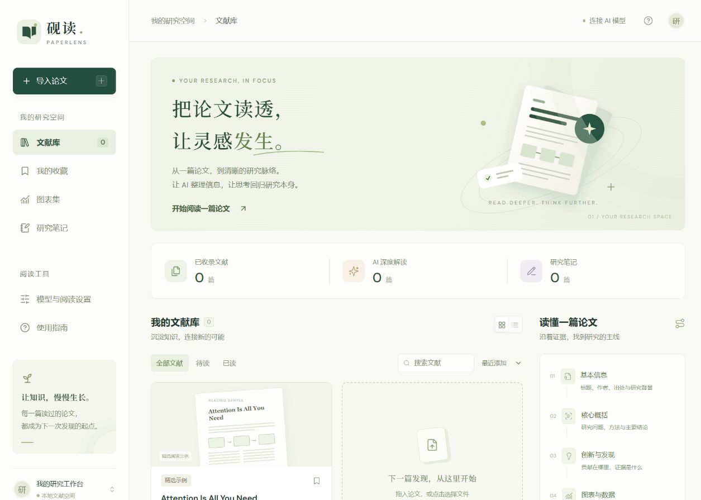
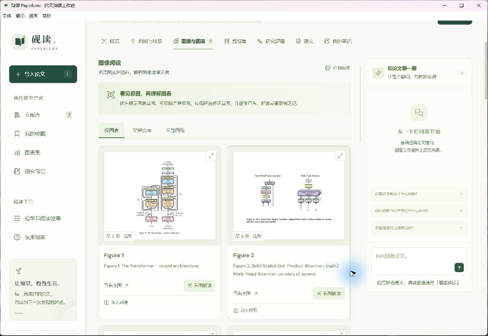
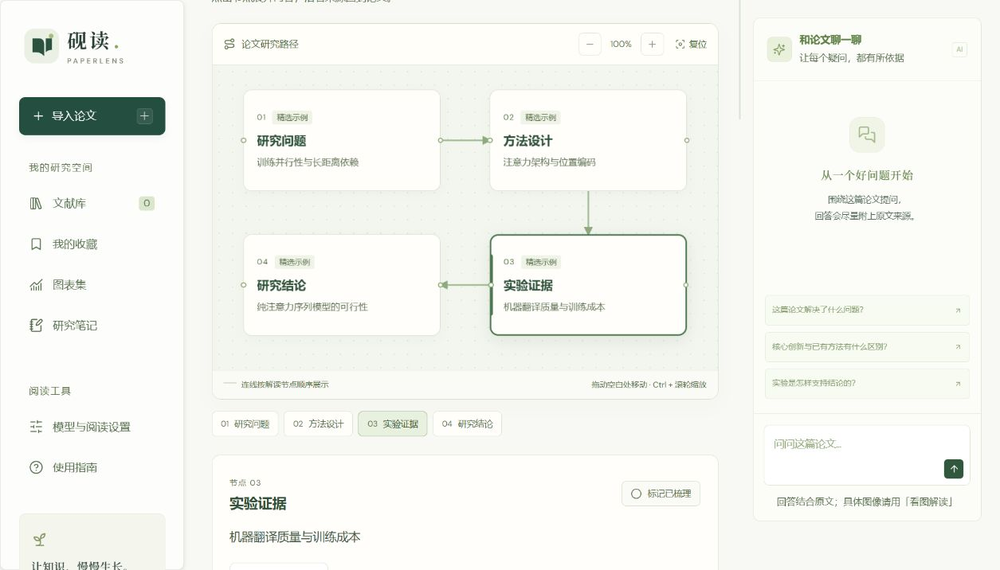
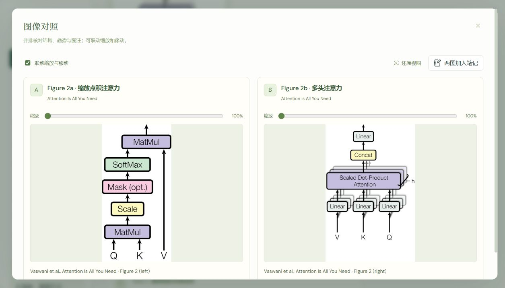
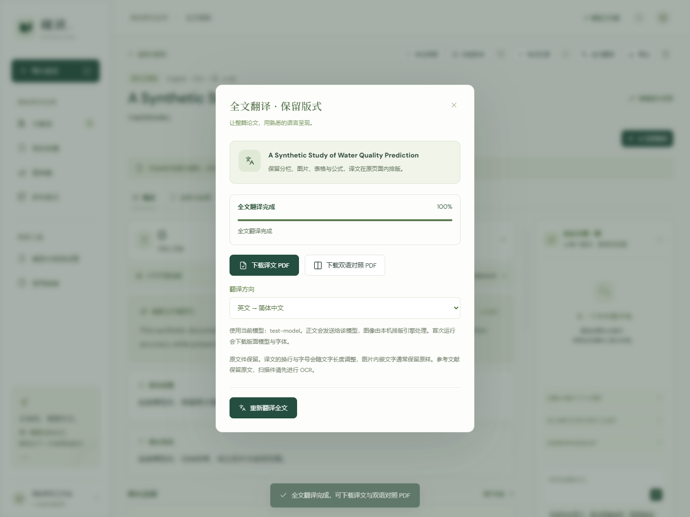

<div align="center">


# 砚读 PaperLens

**把论文读透，让灵感发生。**

面向中英文论文的本地图文阅读工作台 · PDF / Word · AI 解读 · 交互研究画布

[English](README.en.md) · [快速开始](#快速开始) · [使用说明](docs/usage.zh-CN.md) · [反馈与建议](https://github.com/suiyuancanyan/paperlens/issues)

[](LICENSE)
[](https://nodejs.org/)
[](https://github.com/suiyuancanyan/paperlens/stargazers)

</div>

拖入一篇论文，把基本信息、研究问题、方法、创新点、实验结果、图表与数据集整理成可阅读的工作台。沿着原文页码查看证据，在图像之间做对照，把自己的思考留在笔记里。



## 能做什么

| 阅读环节 | 功能 |
| --- | --- |
| 导入与整理 | 批量导入 PDF / DOCX，提取文字与图片，建立本地文献库 |
| 结构化解读 | 整理基本信息、概括、创新与结果、数据集、研究逻辑及来源页码 |
| 图像阅读 | 原图与完整页面切换、放大、框选裁图、逐图 AI 解读 |
| 双图对照 | 同篇或跨论文选择两幅图，联动缩放与移动，带来源加入笔记 |
| 交互画布 | 连接研究问题、方法、证据与结论，点击展开、拖动、缩放 |
| 原文与笔记 | 全文搜索、选词翻译、高亮、图文摘录、阅读位置恢复、修改历史 |
| 全文翻译 | PDF 英中互译，保留原分栏、图表与公式，下载译文版或双语对照版 |
| 论文问答 | 结合原文提问，支持 Markdown、公式与可点击的来源页 |
| 备份与导出 | 导出 Markdown、JSON、SVG 逻辑图及包含原文件的完整文献库备份 |

### 看原图，再理解图表



### 把研究路径放到画布上



### 两幅图，放在一起读



截图中的阅读示例来自 Vaswani 等作者的 *Attention Is All You Need*，图像归原作者所有，详见[第三方说明](THIRD_PARTY_NOTICES.md)。

## 快速开始

安装 [Node.js 22.12 或更高版本](https://nodejs.org/)，然后运行：

```sh
git clone https://github.com/suiyuancanyan/paperlens.git
cd paperlens
npm ci
npm run dev
```

打开 **http://127.0.0.1:4173**。内置阅读示例可直接体验；导入自己的论文后，可先查看原文，再连接模型进行解读。

PDF 渲染资源会在安装时自动准备。Windows 用户完成安装后，也可双击项目中的 `启动砚读.cmd`。

### 连接模型

- **本机 Codex**：使用本机已经登录的 Codex，通过 `codex exec` 调用；应用不读取或复制登录凭据。无需在砚读中填写 Key，使用对应账号的用量。
- **兼容模型 API**：在「模型与阅读设置」中填写基础地址、模型 ID 和 API Key。图像解读需要支持图片输入的模型；也可连接本地兼容服务。

当前代码默认模型为 `gpt-6.1-sol`，可在设置中修改，实际可用性与额度由所选服务或账号决定。高级配置见 [`.env.example`](.env.example) 和[模型连接说明](docs/usage.zh-CN.md#模型连接)。

### Windows 桌面版

在 Windows 上从源码打包：

```sh
npm ci
npm run desktop:pack
```

打开 `release/win-unpacked/PaperLens.exe`。运行时请保留整个 `win-unpacked` 文件夹，可为其中的程序创建桌面快捷方式。桌面包自带运行环境，使用时无需另装 Node.js。

### 一键翻译全文



打开已导入的 PDF，点击阅读页上方的 **全文翻译**，选择英文 → 中文或中文 → 英文，再点击 **翻译全文**。翻译复用当前选择的 Codex 或模型 API，完成后可下载译文 PDF 和双语对照 PDF。原文件保留，支持查看进度、取消任务和刷新后继续查看。翻译与侧栏聊天可同时使用；任务窗默认收起，可拖动、隐藏并记住位置，在侧栏「后台任务」重新打开。相邻段落合批请求模型，已完成段落从本机缓存复用。

翻译排版由独立安装的 [BabelDOC](https://github.com/funstory-ai/BabelDOC) 引擎处理。首次使用前安装 [uv](https://docs.astral.sh/uv/getting-started/installation/)，应用会自动准备隔离的 Python 3.12 环境、版面模型与字体；也可提前运行：

```sh
npm run translation:setup
```

普通阅读不需要 Python。全文翻译目前支持可提取文字的 PDF；Word 请先另存为 PDF，扫描件先进行 OCR。图片内嵌文字通常保留原样，译文的换行和字号会在原段落区域内调整，参考文献保留原文。正文发送到你选择的模型服务，不会自动转发到其他翻译服务。译文 PDF 请单独下载备份，文献库 JSON 备份包含翻译记录而不包含生成的 PDF。详情见[全文翻译说明](docs/usage.zh-CN.md#全文翻译)。

### 生产运行

```sh
npm run build
npm start
```

本机服务默认仅监听 `127.0.0.1`。

## 数据保存在哪里

- **网页版**：文献、原文件、解读和笔记保存在当前浏览器的 IndexedDB。清理站点数据或更换浏览器、端口，会影响可见文献库。
- **Windows 桌面版**：文献和笔记写入「文档 → PaperLens资料」，可从「帮助 → 打开资料文件夹」定位。应用设置和运行记录保存在 `%APPDATA%\PaperLens`。
- **调用 AI 时**：相关文字、对话和所选附图发送给你配置的模型服务。自定义 API Key 保存在页面内存，刷新后需重新填写；也可自行配置本机 `.env`。
- **备份**：「使用指南」中可导出包含原文件的完整备份，也可以在另一环境中恢复。备份不包含 API Key。

## 当前边界

支持 PDF 和 `.docx`，单篇最大 50 MB；旧版 `.doc` 请先转换。Word 中的 EMF/WMF、原生图表可先另存为 PDF。图表裁图基于页面布局和图注位置，可手动调整边界。

整篇解读最多附带 6 张图片和 18 万字符；更多图像可逐张解读。扫描 PDF 可以按页读图；跨页文字与复杂版面仍可能需要人工核对。AI 解读中的来源页码便于回到原文检查。

## 参与改进

欢迎提交 [Issue](https://github.com/suiyuancanyan/paperlens/issues) 和 Pull Request。我们尤其希望改进复杂版面裁图、扫描文档 OCR、Word 公式与图表、桌面安装体验和阅读可访问性。

```sh
npm test
npm run build
```

测试使用本地模拟服务与合成材料，无需真实模型账号。开发与反馈指南见 [CONTRIBUTING.md](CONTRIBUTING.md)。

如果砚读帮你把一篇论文读得更清楚，欢迎点一个 **Star ⭐**，也欢迎把实际阅读中的问题告诉我们。

## 开源许可

项目代码采用 [MIT License](LICENSE)。第三方库、字体和论文示例图保留各自的许可与署名，详见 [THIRD_PARTY_NOTICES.md](THIRD_PARTY_NOTICES.md)。
